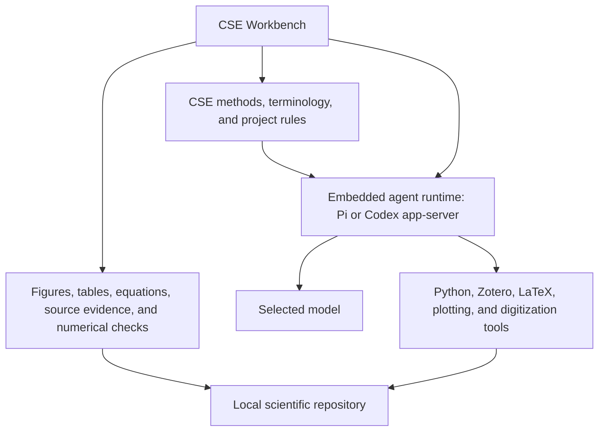

# Agent harness landscape for a CSE Workbench

Status: paused
Last reviewed: 2026-08-25

## Question

Should CSE remain a plugin inside a general coding application, or should it
become a standalone application whose interface and agent behavior are designed
for computational science and physical-world engineering?

## Current answer

CSE should mature the Codex plugin before resuming a standalone Workbench. The
Workbench research remains useful, but implementation should wait for repeated
plugin use to identify limitations that instructions, references, repository
checks, and supporting tools cannot address cleanly.

The standalone application can replace the ChatGPT or Codex desktop interface
for CSE work while embedding either Codex app-server or Pi. The distinction is
important:

- replacing the user interface and scientific behavior is justified;
- replacing model calls, message streaming, retries, compaction, and every
  execution primitive is not yet justified; and
- the current plugin should remain available until measured CSE tasks show that
  the Workbench is better.

## What a harness changes

Model weights remain fixed. Observed agent behavior nevertheless depends on the
complete execution system around the model:

`observed behavior = model + reasoning setting + instructions + selected input + tools + execution loop + permissions + interface`

The surrounding system controls:

- the system and developer instructions;
- which repository files and prior messages are supplied;
- tool names, descriptions, argument schemas, and returned values;
- how the model alternates between reasoning and tool calls;
- memory, retained reasoning, and compaction;
- allowed files, processes, networks, and remote actions;
- when user approval is required;
- how failures and partial results return to the model; and
- what the user can inspect, interrupt, correct, and approve.

OpenAI reports that retained reasoning and improved compaction changed GPT-5.6
Sol's ARC-AGI-3 score from 13.3% to 38.3% while reducing output tokens sixfold.
That result does not predict a CSE gain, but it demonstrates that harness design
can materially affect capability and efficiency. See
[Codex as a platform](https://developers.openai.com/blog/codex-as-a-platform).

## Investigated systems

| System | Agent loop | Primary customization | CSE interpretation |
|---|---|---|---|
| Codex app, CLI, and IDE | Open-source Codex harness | Skills, project instructions, tools, sandbox settings, and host interface | Strong OpenAI-model baseline with built-in execution safeguards |
| Codex app-server | Same Codex harness exposed to another application | Application-owned interface, MCP tools, approvals, and project information | Strong candidate when Sol, Terra, and Luna are the priority |
| Claude Code | Claude Code gather-act-check loop using Claude models | Project files, skills, MCP, hooks, subagents, permissions, and checkpoints | Useful comparison; not an official GPT runtime |
| Pi | Small multi-provider agent loop | System prompt, skills, extensions, tools, model providers, events, compaction, and host UI | Strong candidate when CSE must control the agent's default behavior |
| Hermes | Provider routing with layered identity, memory, tools, skills, and platform hints | Identity, persistent memory, project files, prompt layers, tools, and plugins | Demonstrates how prompt assembly and memory can strongly condition style |
| T3 Code | Server and clients around provider command-line agents | Workspaces, sessions, terminals, checkpoints, provider adapters, and remote clients | Useful interface reference; broader than the first CSE application needs |

Claude Code describes its harness as the tools, input management, and execution
environment around its models. Its interface may change while the underlying
agent loop remains the same. See
[How Claude Code works](https://code.claude.com/docs/en/how-claude-code-works).

Hermes documents distinct prompt layers for identity, tool guidance, skills,
project files, memory, user preferences, and interface-specific hints. See
[Hermes prompt assembly](https://hermes-agent.nousresearch.com/docs/developer-guide/prompt-assembly/).

T3 Code runs provider command-line agents behind a server that owns sessions,
workspaces, terminals, and version-control checkpoints. See
[T3 Code architecture](https://github.com/pingdotgg/t3code/blob/main/docs/internals/overview.md).

## Speed and efficiency

The useful metric for CSE is time to a defensible result, not time to the first
token. A harness changes that time through:

- instruction length and provider-side prompt caching;
- model and reasoning-level selection;
- the number of model calls and tool round trips;
- tool startup and shell execution time;
- repeated repository discovery;
- the amount and quality of retained state after compaction;
- concurrent work, when it is scientifically separable; and
- how quickly the user can inspect tables, equations, figures, and failures.

A smaller prompt and tool set can improve speed. Poor compaction, excessive
automatic review, broad tool results, or unnecessary state transitions can
erase that gain. Native scientific views may reduce both tokens and correction
turns by presenting exact values directly instead of describing them in prose.

## Proposed product boundary

The application should own:

- project selection and project-specific scientific vocabulary;
- quantities, units, bases, assumptions, and validity bounds;
- retained result tables and figure descriptions;
- equation records and exact source locators;
- numerical residuals, balances, invariants, convergence, sensitivity, and
  uncertainty results;
- Zotero evidence and approved bibliography operations;
- LaTeX, TikZ, and PGFPlots previews;
- figure digitization calibration and QA views;
- permission decisions and remote-write approvals; and
- final result presentation.

The embedded agent runtime should initially continue to own:

- model access;
- message and tool-call streaming;
- conversation history;
- retries and interruption;
- compaction;
- basic file and shell tools; and
- model-specific request formatting.

## Mapping the current plugin into the Workbench

| Current CSE material | Possible Workbench form |
|---|---|
| Workflow skills | Application actions plus instructions loaded only for the selected endpoint |
| Supporting-tool skills | Typed tools with visible inputs, outputs, and failure states |
| `operating-model.md` | Application navigation rules and model instructions |
| `scientific-method.md` | Project records, review questions, and result checks |
| `numerical-testing.md` | Executable reference-case and numerical-behavior checks |
| `plotting.md` | Figure schema, renderer, viewer, and figure warnings |
| `terminology.md` and `BANNED.md` | Model guidance plus a precise prose checker |
| Git reference | Permission-aware local Git actions and separately approved remote writes |
| Zotero reference | Source-evidence pane and separately approved library actions |

The plugin skills should not be copied into a second authoritative set. During
prototyping, the Workbench can load them directly. If the application succeeds,
shared CSE instructions and schemas should become the single source used by the
Workbench and a thin Codex plugin adapter.

## Native scientific figure behavior

A figure should be a structured scientific result rather than only an image.
The figure description should identify:

- the exact retained table and columns;
- x and y quantities, units, and scales;
- transformations;
- each series role: observation, fitted relationship, prediction, reference
  case, or uncertainty;
- uncertainty meaning;
- renderer and rendering environment;
- PNG, SVG, and PDF paths; and
- checks and warnings.

The application can then enforce machine-detectable figure rules:

- observations use `o` or `x` points;
- a continuous fitted relationship uses a line;
- a bar chart is refused for continuous data unless the user records a reason;
- color is not the only visual distinction;
- axes identify quantities and units;
- logarithmic and truncated scales are explicit; and
- rendered values agree with the retained table.

## Three levels of behavioral control

1. Model instructions guide judgments that cannot be reduced to syntax, such
   as source applicability, assumptions, competing explanations, and claim
   limits.
2. Typed tool arguments require quantities, units, series roles, source paths,
   and uncertainty meaning before an operation runs.
3. Deterministic checks detect missing units, forbidden figure forms, absent
   retained values, broken LaTeX, vague terminology, and unapproved writes.

This cannot remove every unwanted tendency from model weights. It can make
machine-detectable failures rare and expose scientific reasoning failures for
review.

## Product paths

| Path | Benefit | Limitation | Current disposition |
|---|---|---|---|
| Keep only the plugin | Lowest maintenance and broad Codex compatibility | Advisory behavior and no CSE-native interface | Preserve as the current product |
| Standalone CSE app with Codex app-server | Retains the OpenAI-tuned loop, sandbox, and approvals | OpenAI-centered and less control over the inner loop | Retain as a leading candidate |
| Standalone CSE app with Pi | Deep control, multi-provider support, embeddable SDK, small defaults | CSE must supply permission boundaries and graphical rendering | Retain as a leading candidate |
| New agent runtime from raw model APIs | Maximum theoretical control | Reimplements difficult, already-solved behavior | Reject without measured blocking evidence |
| T3-style multi-provider session server | Many clients and provider command-line agents | Far larger than the first CSE use requires | Reject for the first prototype |

## Provisional recommendation

Build one narrow CSE Workbench prototype before changing the plugin's accepted
status. Compare Pi and Codex app-server only where the comparison can answer a
real decision. Do not build a complete editor, remote service, multi-agent
system, or provider abstraction first.

The first useful interface needs a task view, figure and table panes, equation
and source locators, numerical-check results, approvals, and links that open
source code in the user's existing editor.

## Unresolved questions

- Does Pi preserve Sol, Terra, and Luna performance on representative CSE work
  as well as the Codex harness?
- Which runtime produces fewer unnecessary files, tests, and release
  assumptions under the same CSE instructions?
- Can a permission boundary remain understandable while supporting local
  compilers, Python environments, LaTeX, Zotero, and optional accelerators?
- Which scientific result types need native views after figures and tables?
- Should the first application embed a runtime in-process or use a separate
  local process?
- Can one shared CSE instruction source serve both the application and plugin
  without adding a generation framework?

## Primary sources

- [OpenAI: Codex as a platform](https://developers.openai.com/blog/codex-as-a-platform)
- [OpenAI: Codex app-server](https://learn.chatgpt.com/docs/app-server)
- [Claude Code: how the agent works](https://code.claude.com/docs/en/how-claude-code-works)
- [Pi agent harness](https://github.com/earendil-works/pi)
- [Pi SDK](https://pi.dev/docs/latest/sdk)
- [Pi extensions](https://pi.dev/docs/latest/extensions)
- [Hermes prompt assembly](https://hermes-agent.nousresearch.com/docs/developer-guide/prompt-assembly/)
- [T3 Code architecture](https://github.com/pingdotgg/t3code/blob/main/docs/internals/overview.md)
