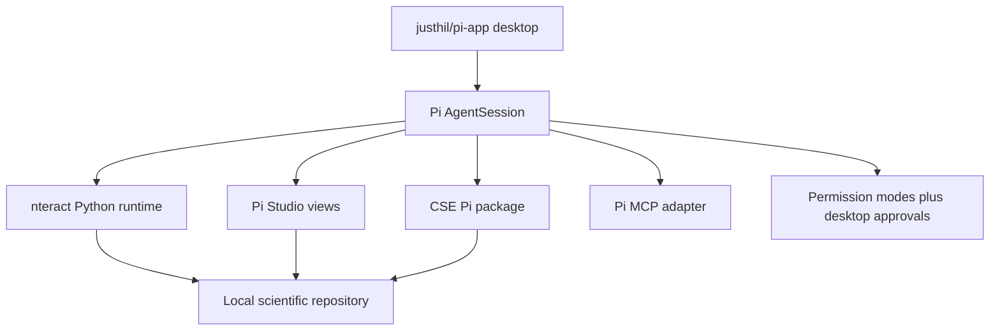

# Open-source Pi ecosystem audit for a CSE Workbench

Status: paused
Last reviewed: 2026-08-25

## Direct answer

CSE does not need to start from an empty desktop application or an empty Pi
extension package.

Open-source projects already cover four large parts of the proposed Workbench:

1. a graphical Pi session and extension host;
2. persistent Python notebook execution with rich output;
3. Markdown, LaTeX, PDF, image, table, and Quarto views; and
4. external-tool connections and local execution controls.

No reviewed project supplies the CSE scientific working method, terminology,
figure rules, retained-result descriptions, source-evidence rules, or
verification distinctions. Those remain the reason for a CSE-owned Pi package.
The economical path is therefore to assemble and test existing pieces before
forking a desktop application.

## Best available pieces

| Need | Candidate | What can be reused | Material limitation | Current disposition |
|---|---|---|---|---|
| Desktop Pi host | [`justhil/pi-app`](https://github.com/justhil/pi-app) | MIT Electron application using Pi `AgentSession`, native extension dialogs, tool cards, file views, diffs, session navigation, and external adapter descriptions | Its Pi Studio support is partial; a CSE figure or numerical-results pane still needs a new generic desktop view | First desktop source to test |
| Scientific browser workspace | [`pi-studio`](https://github.com/omaclaren/pi-studio) | MIT Pi extension with Markdown and LaTeX editing, image and PDF views, CSV and TSV tables, Quarto preview, Git changes, Python/IPython/Julia/R sessions, and PDF/HTML export | It opens a local browser workspace and describes itself as a terminal companion, not a complete desktop replacement; the implementation is large for one extension | Use intact for an early trial; borrow only after a focused source review |
| Persistent Python computation | [`@nteract/pi`](https://github.com/nteract/nteract/tree/main/plugins/nteract/pi) | BSD-3-Clause Pi extension backed by the nteract daemon; preserves variables and imports, returns Matplotlib and other rich outputs, manages dependencies, reads Arrow and Parquet results, and saves notebooks | Requires the nteract daemon and currently centers Python rather than Julia or R | Preferred Python execution candidate |
| Native scientific notebook app | [`nteract`](https://github.com/nteract/nteract) | Open-source Tauri notebook application, synchronized notebook state, managed kernels, rich tables and figures, and an agent-accessible daemon | It is a notebook application rather than a repository-wide agent workbench | Reuse its daemon and notebook view; do not turn CSE into a notebook-only application |
| Notebook file editing | [`@xl0/pi-lovely-notebook`](https://github.com/xl0/pi-lovely-notebook) | MIT, cell-addressed `.ipynb` reads and edits, serialized mutations, output preservation, image-output reads, and a small tested core | Does not execute cells | Optional complement when exact notebook editing is needed |
| Multi-language live sessions | [`pi-repl`](https://github.com/omaclaren/pi-repl) | MIT Pi tools for persistent Python, IPython, Julia, R, GHCi, and Clojure sessions | Requires tmux; results are primarily terminal text and process history rather than typed scientific results | Keep as a Julia/R fallback, not the primary Python path |
| LaTeX and report preview | [`pi-markdown-preview`](https://github.com/omaclaren/pi-markdown-preview) | MIT extension for Markdown/LaTeX rendering, browser and PDF preview, Mermaid, local images, and PDF/HTML/PNG export | Overlaps Pi Studio and does not define scientific figure meaning | Use only if Pi Studio is not loaded or its smaller surface is preferable |
| External tools | [`pi-mcp-adapter`](https://github.com/nicobailon/pi-mcp-adapter) | MIT MCP client with stdio and HTTP transports, secure-store OAuth, direct or discovered tools, approval rules, and MCP interactive UI support | It is a substantial general MCP implementation; each connected server remains separately trusted | Adopt as a dependency after review; do not reimplement MCP |
| Local execution controls | [`pi-permission-modes`](https://github.com/wynainfo/pi-permission-modes) | MIT extension with allow/ask/deny rules, shell parsing, Bubblewrap on Linux, and `sandbox-exec` on macOS | Its own security document states parser and sandbox limits; CSE tools and desktop code still require a verified host boundary | Prototype candidate, not proof of complete isolation |

The package versions and source repositories were checked on the review date.
Third-party Pi extensions execute with the user's permissions unless a separate
operating-system boundary limits them. Source and dependency review is required
before installation.

## Why `justhil/pi-app` moved ahead

The earlier feasibility review treated `pi-gui` as the most promising thin
desktop shell. Source inspection found that `justhil/pi-app` has a more useful
extension boundary for CSE:

- Pi runs through its supported SDK rather than a custom agent loop;
- the desktop already translates Pi question and confirmation requests into
  native dialogs;
- extension adapters are data files rather than package-name branches spread
  through the application;
- built-in adapters already recognize Pi Studio, `pi-mcp-adapter`,
  `pi-markdown-preview`, image generation, and structured questions;
- tools can return paths that the desktop opens as images or documents; and
- project-level adapter descriptions can be supplied without rebuilding the
  application.

The current adapter descriptions support generic tool cards and a small set of
side-panel components. They do not yet provide a general scientific-figure
component with exact tables, units, series roles, uncertainty, and warnings.
That missing view is narrow enough to prototype without designing a new desktop
framework.

## Other graphical bases

| Project | Useful evidence | Reason it is not the first choice |
|---|---|---|
| [`gustavonline/pi-desktop`](https://github.com/gustavonline/pi-desktop) | MIT Tauri application with Pi RPC, package management, native extension questions, files, terminal, sessions, and a deliberately small host boundary | Its host supports Pi's fixed RPC interaction methods but not arbitrary graphical scientific panes; it would require more host work than `justhil/pi-app` |
| [`pi-gui`](https://github.com/minghinmatthewlam/pi-gui) | MIT Electron shell with a thin Pi SDK adapter, workspaces, worktrees, terminal, and diffs | Good SDK reference, but the reviewed source descriptions expose less extension-to-desktop adaptation than `justhil/pi-app` |
| [`vastsa/PI-Desktop`](https://github.com/vastsa/PI-Desktop) | Complete local application with a Rust host, approvals, plugin panels, skills, MCP, and a Pi-derived agent process | LGPL-3.0 and substantially broader than the first CSE question; adopting it would also adopt a second plugin system and more application behavior to remove |
| [`AnnoVibe`](https://www.npmjs.com/package/@seqyuan/annovibe) | MIT Pi-based bioinformatics browser workspace with streaming figures, file editing, document viewers, session branching, and model selection | The npm metadata reviewed on 2026-08-20 did not identify a public source repository, so it is evidence that the interface is possible but not an acceptable source base yet |

## Science-adjacent packages that do not solve the main need

- [`pi-inline-viz`](https://github.com/yanyaoer/pi-inline-viz) has a careful
  SVG-to-image design for terminal diagrams and display equations. Its chart
  adapter is still planned, and its output target is the terminal rather than a
  CSE desktop pane.
- [`@narumitw/pi-jupyter`](https://pi.dev/packages/%40narumitw/pi-jupyter)
  previews notebooks in Pi's interactive terminal UI. It does not provide the
  desktop notebook execution and shared rich output already available from
  nteract.
- `@seqyuan/pi-kernel-plot` advertises warm R/Python plot handling, but its npm
  repository URL returned "repository not found" during this review. Do not
  select it as an open-source dependency until the source and maintenance path
  are publicly inspectable.
- General scientific skill bundles are not substitutes for CSE. They would add
  overlapping instructions without supplying the graphical result types or
  CSE-specific working method.

## Recommended first assembly

Use existing packages without forking them for the first measured trial:

The CSE family should initially contain only:

- the existing one-plugin instructions from one shared authoritative source:
  21 callable skills across the three canonical phases;
- one typed scientific-figure result description;
- one typed numerical-check result description;
- the terminology and banned-language checks;
- the existing figure semantics: observations as `o` or `x` points,
  continuous fitted relationships as lines, and no bar chart for continuous
  data without a recorded scientific reason; and
- CSE-specific tool and remote-write approval rules.

The first trial can use existing image and file preview behavior. A custom
scientific side panel is justified only after the retained values and warnings
prove materially better than opening the generated PNG, SVG, PDF, and CSV
files.

## What still requires CSE implementation

No existing package reviewed here supplies:

- the 21 callable CSE skills and their continuation rules;
- the four source and six rendering specialist skills within the unified
  `cse` plugin as a coherent installed family;
- distinction among code verification, solution verification, model
  validation, and uncertainty analysis;
- quantity, unit, basis, assumption, and validity-bound records;
- source locators and Zotero ownership rules;
- the required line-versus-point scientific figure semantics;
- calibrated figure digitization with independent QA;
- local-only project behavior that still permits an approved private GitHub
  remote; or
- CSE terminology and banned vague language.

These are a small CSE-owned behavior layer over existing execution and viewing
code. They do not justify a new model client, notebook runtime, MCP client,
LaTeX renderer, or desktop session manager.

## Decision after this audit

Start with an assembled trial, not a new desktop repository:

1. Run `justhil/pi-app` with Pi Studio, `@nteract/pi`, the Pi MCP adapter, and a
   reviewed permission extension.
2. Load a minimal CSE Pi package from the current source repository.
3. Perform one model-versus-observation plotting task and one numerical
   convergence task.
4. Record which required values cannot be inspected clearly through existing
   tool cards, file views, and notebook output.
5. Fork the desktop shell only if that evidence identifies a specific missing
   graphical component.

This route tests the CSE product decision while preserving the option to replace
any third-party component independently.

## Primary sources

- [Pi extension documentation](https://pi.dev/docs/latest/extensions)
- [Pi package documentation](https://pi.dev/docs/latest/packages)
- [`justhil/pi-app`](https://github.com/justhil/pi-app)
- [`pi-studio`](https://github.com/omaclaren/pi-studio)
- [`@nteract/pi` source](https://github.com/nteract/nteract/tree/main/plugins/nteract/pi)
- [nteract desktop and daemon](https://github.com/nteract/nteract)
- [`@xl0/pi-lovely-notebook`](https://github.com/xl0/pi-lovely-notebook)
- [`pi-repl`](https://github.com/omaclaren/pi-repl)
- [`pi-markdown-preview`](https://github.com/omaclaren/pi-markdown-preview)
- [`pi-mcp-adapter`](https://github.com/nicobailon/pi-mcp-adapter)
- [`pi-permission-modes`](https://github.com/wynainfo/pi-permission-modes)
- [`pi-landstrip`](https://pi.dev/packages/pi-landstrip)
