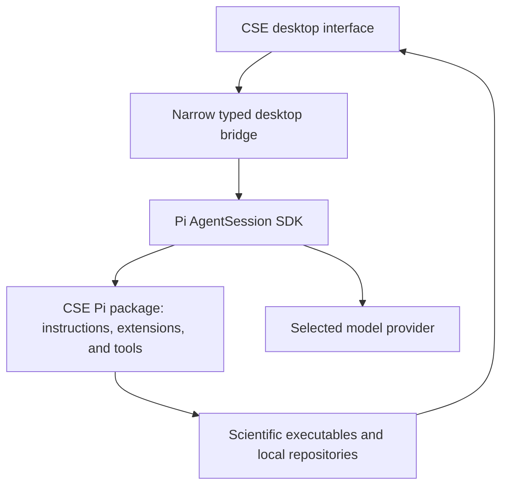

# Pi feasibility for a CSE Workbench

Status: paused
Last reviewed: 2026-08-25

## Direct answer

Pi can serve as the agent runtime for a graphical CSE Workbench.

Upstream Pi's complete built-in interface is a terminal UI, not a desktop
application. However, Pi intentionally exposes two supported application
interfaces:

- its TypeScript SDK embeds Pi directly in a Node application and explicitly
  lists web, desktop, and mobile interfaces as use cases; and
- RPC mode exposes a JSONL protocol over standard input and output for IDEs and
  custom clients written in other languages.

Several independent projects already provide real desktop or web interfaces
for Pi. Therefore the question is not whether a Pi graphical application is
possible. The remaining question is whether CSE should build on an existing Pi
interface or use the Pi SDK in a small purpose-built application.

## Upstream Pi surfaces

Pi provides:

- a multi-provider model layer, including OpenAI, Anthropic, Google, and other
  providers;
- persistent tree-structured sessions;
- streaming message and tool events;
- model and reasoning-level selection;
- configurable compaction and retries;
- a replaceable system prompt;
- skills and project instruction discovery;
- custom tools;
- TypeScript extensions;
- SDK embedding; and
- RPC embedding.

The SDK's `AgentSession` manages message history, model state, compaction,
streaming, steering, aborts, and session navigation. For a TypeScript desktop
application, Pi recommends using the SDK directly rather than spawning an RPC
subprocess. See [Pi SDK](https://pi.dev/docs/latest/sdk) and
[Pi RPC mode](https://pi.dev/docs/latest/rpc).

Pi is also developing transport-neutral client, protocol, and server packages.
The current server package is explicitly experimental and requires the host
application to supply the coding-agent service. It should not be a dependency
of the first CSE prototype. See
[Pi client](https://github.com/earendil-works/pi/tree/main/packages/client) and
[Pi server](https://github.com/earendil-works/pi/tree/main/packages/server).

## Existing graphical applications

These are independent projects, not upstream Pi releases.

| Application | Form | Relevant evidence | CSE interpretation |
|---|---|---|---|
| [pi-gui](https://github.com/minghinmatthewlam/pi-gui) | MIT Electron desktop app, currently beta on macOS and Linux | Codex-style timeline, workspaces, Pi SDK adapter, terminal, diffs, skills, and provider settings | Strongest codebase to inspect as a possible shell or design reference |
| [Pi Desktop](https://github.com/FaqFirebase/pi-desktop) | Apache-2.0 Electron app in alpha for Linux, macOS, and Windows | File and PDF preview, CodeMirror editor, terminal, package browser, permission modes, and review rail | Useful reference for cross-platform packaging and visible permissions |
| [pi Desktop](https://github.com/justhil/pi-app) | MIT Electron desktop shell | Pi session sharing, KaTeX, file panes, extension adapters, and native dialogs | Useful evidence for translating Pi extension interactions into desktop controls |
| [pi-web-ui](https://pi.dev/packages/pi-web-ui) | MIT browser application distributed through the Pi package registry | In-process Pi SDK, streaming chat, terminal, files, Git, models, skills, and extensions | Fast browser prototype; contains more general coding behavior than CSE initially needs |

The existence of these applications proves the embedding route, but none
should be adopted without a focused source, license, dependency, security, and
maintenance review.

## What CSE can implement as Pi extensions

Pi extensions can:

- replace or modify the system prompt before an agent run;
- contribute CSE skills and prompt templates;
- register scientific tools with typed arguments;
- block or modify tool calls;
- modify messages before model requests;
- inspect or replace provider request payloads;
- modify tool results before they return to the model;
- customize compaction;
- add session records for CSE state;
- register commands and shortcuts;
- ask questions and request confirmation; and
- select active tools, models, and reasoning levels.

Those capabilities are sufficient for a CSE Pi package containing:

- the current three-package instructions: nine core workflow skills, four
  optional Sources skills, and seven optional Visualize skills;
- a project-profile reader;
- scientific terminology guidance and prose checks;
- figure-description and result-table schemas;
- scientific file and Git permission checks;
- CSE-specific compaction instructions; and
- retained session entries for the selected question, assumptions, quantities,
  methods, source locators, and unresolved decisions.

Pi documents event interception, tool blocking, prompt changes, custom tools,
session persistence, and custom compaction in
[the extension guide](https://pi.dev/docs/latest/extensions).

## What extensions alone cannot provide

Pi extension UI components are terminal components. They can draw custom TUI
views, dialogs, widgets, and tool-result renderings. They do not automatically
become arbitrary React, Electron, Tauri, or native desktop components.

In RPC mode, Pi forwards select, confirm, input, editor, notification, status,
and text-widget requests to the host client. Pi's arbitrary `custom()` terminal
component is unavailable in RPC mode. The host application must implement rich
scientific panes itself.

Therefore extensions alone can create a CSE-flavored terminal agent. A
Codex-style graphical CSE application requires both:

1. a CSE Pi package for agent behavior and scientific tools; and
2. a desktop or web application for figures, tables, equations, PDFs, source
   evidence, and numerical-check views.

## Recommended Pi architecture

For a TypeScript desktop application, the smallest credible design is:

The Pi SDK should run in the desktop main process. A sandboxed renderer should
receive only typed events and approved result files through a narrow desktop
bridge. This follows the useful separation demonstrated by `pi-gui` without
requiring a fork of Pi itself.

The first prototype should use Pi's supported `AgentSession` API directly.
RPC remains useful if the application later uses a non-Node host or isolates Pi
in a separate process.

## Native CSE tool results

Each CSE tool should return a small machine-readable result plus exact file
paths. The desktop application renders the result by type.

Examples:

| Result type | Required values | Native view |
|---|---|---|
| Scientific figure | Table, quantities, units, series roles, uncertainty, scales, and output paths | Interactive figure, exact-value table, and warnings |
| Numerical check | Method, case, metric, tolerance rationale, value, and status | Residual, balance, convergence, or sensitivity pane |
| Equation evidence | Stable equation ID, symbols, units or basis, assumptions, and source locator | Rendered equation and source pane |
| Digitized series | Source figure, calibration, axis transforms, points, uncertainty, and QA result | Calibration overlay and retained CSV |
| LaTeX figure | Source, input table, compiled output, and build result | TikZ or PGFPlots source beside rendered PDF or SVG |

The UI should not infer scientific meaning from arbitrary terminal text. Tool
schemas should carry that meaning explicitly.

## Permission and isolation risk

Pi does not include a built-in permission system for filesystem, process,
network, or credential access. By default it runs with the rights of the user
and process that launched it. Pi recommends a container or sandbox when a
stronger boundary is needed. See
[Pi permissions and containerization](https://github.com/earendil-works/pi#permissions--containerization).

A CSE extension can block tools and ask for confirmation, but a prompt is not a
security sandbox. An existing Pi GUI's allow and deny rules are also not enough
to isolate a malicious process or command.

The CSE application must decide and verify:

- which repository roots are readable and writable;
- which commands may run without confirmation;
- how network access is restricted;
- where model credentials live;
- how a local-only project differs from a remote write;
- whether LaTeX, Python, compilers, Zotero, and accelerators run on the host or
  inside an isolated environment; and
- how the user reviews a requested permission before granting it.

This is Pi's largest disadvantage relative to Codex app-server, which already
contains sandbox and approval behavior.

## Pi compared with Codex app-server

| Question | Pi | Codex app-server |
|---|---|---|
| Can CSE replace the system prompt? | Yes, directly | CSE primarily adds skills, tools, and application-supplied instructions |
| Can CSE intercept and modify tool calls? | Yes, through extensions | The application can own tools and approvals; inner-loop control is narrower |
| Can CSE customize compaction? | Yes | Codex owns compaction behavior |
| Can the application use several model providers? | Yes | Primarily OpenAI models |
| Are Sol, Terra, and Luna running in their native Codex harness? | No | Yes |
| Is a sandbox and approval system included? | No built-in sandbox | Yes |
| Is a custom desktop interface supported? | Yes through SDK or RPC | Yes through app-server |
| Are real graphical examples available? | Several independent apps | OpenAI clients and the Relay example |

## Provisional recommendation

Pi should be the first CSE-owned-behavior prototype candidate because it allows
the system prompt, tools, events, compaction, and model selection to be shaped
without forking the runtime. Use the Pi SDK plus a CSE extension package and a
very small graphical shell.

Do not yet select Pi as the permanent base. First compare it with Codex
app-server on representative CSE tasks. In particular, verify whether OpenAI
models retain their coding and scientific performance outside the Codex
harness, and measure the cost of supplying a safe local execution boundary.

If an existing GUI is used to accelerate the prototype, inspect
`justhil/pi-app` first. The subsequent
[Pi ecosystem audit](PI-ECOSYSTEM-AUDIT.md) found that this desktop already
translates Pi extension
interactions into desktop controls and includes adapters for Pi Studio, the Pi
MCP adapter, Markdown preview, and structured questions. Pi Studio and nteract
also supply much of the scientific viewing and notebook behavior needed by the
first prototype. Preserve `pi-gui` as a smaller SDK reference rather than an
automatic fork.

## Smallest useful prototype

1. Embed Pi with `AgentSession` in a minimal desktop shell.
2. Load the current CSE skills without copying their authoritative text.
3. Add one CSE extension with a typed `render_scientific_figure` tool.
4. Return an exact table, units, series roles, PNG, SVG, and PDF paths.
5. Render the figure and retained values in a native pane.
6. Add one visible approval before a file-changing shell or write tool.
7. Run the same task through Codex app-server.
8. Compare scientific errors, unnecessary files, user corrections, wall time,
   model and tool calls, and tokens.

Stop before adding an integrated editor, multi-agent behavior, cloud service,
remote execution, or general package marketplace. Those features do not answer
the initial runtime decision.

## Open questions

- Which Pi graphical application has the smallest maintainable shell for a CSE
  prototype after source inspection?
- Can CSE extensions return typed details that an unmodified Pi GUI can render,
  or does the GUI need a CSE result-renderer registry?
- Which isolation method supports local scientific tools without making setup
  burdensome?
- Can ChatGPT subscription authentication for OpenAI models be used reliably in
  an embedded Pi application without copying private credentials?
- How should CSE instructions survive compaction without repeating the full
  plugin on every model call?
- Does provider flexibility materially help CSE, or does it increase testing
  and behavioral variation more than it helps?

## Primary sources

- [Pi project](https://github.com/earendil-works/pi)
- [Pi SDK](https://pi.dev/docs/latest/sdk)
- [Pi RPC mode](https://pi.dev/docs/latest/rpc)
- [Pi extensions](https://pi.dev/docs/latest/extensions)
- [Pi coding agent](https://github.com/earendil-works/pi/tree/main/packages/coding-agent)
- [pi-gui](https://github.com/minghinmatthewlam/pi-gui)
- [Pi Desktop](https://github.com/FaqFirebase/pi-desktop)
- [pi Desktop](https://github.com/justhil/pi-app)
- [pi-web-ui](https://pi.dev/packages/pi-web-ui)
